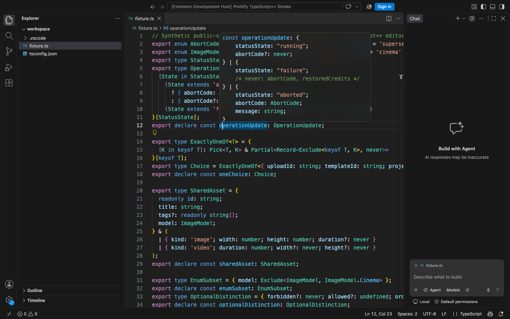

# Prettify TypeScript++

Read complex TypeScript types in your hover, including the original definition that produced them.

[VS Code Marketplace](https://marketplace.visualstudio.com/items?itemName=EthanSK.prettify-ts-plus-plus) ·
[Report a bug](https://github.com/EthanSK/prettify-ts-plus-plus/issues) · [Changelog](CHANGELOG.md)

**Preview:** tested with TypeScript 5.9 and 6.0 using VS Code's JavaScript TypeScript language service.
TypeScript 7 native preview is not supported. See [compatibility](#compatibility) for the tested scope.

An independent fork of [Prettify TypeScript](https://github.com/mylesmmurphy/prettify-ts), created by
[Myles Murphy](https://github.com/mylesmmurphy). The original MIT licence and attribution are retained.



## Install

Install **Prettify TypeScript++** by **Ethan Sarif-Kattan** from the Marketplace, or run:

```sh
code --install-extension EthanSK.prettify-ts-plus-plus
```

If the original Prettify TypeScript extension is installed, disable it for this workspace to avoid competing
prettified hovers. Keep VS Code's built-in TypeScript language features enabled.

Hover a type or value in a TypeScript, JavaScript, TSX, JSX or Vue file. The popup can show:

1. **Prettified type** — the expanded type, with useful names and clearer exclusions.
2. **Source** — the definition as written, when it adds useful information.
3. **Normal TypeScript hover** — the information supplied by VS Code's language service.

If an already-open project still uses the previous plugin, run **TypeScript: Restart TS Server** when it is
convenient to interrupt language features. An installation on disk does not prove an existing server reloaded it.

## What changes

- **Useful names stay visible.** Whole enums and matching nested union aliases keep their names. Subsets and
  individual enum members remain distinct, and the root type still expands.
- **Generic uses show their actual types.** Hover `Box<number>` to see its numeric fields. A skipped field
  can read `Map<...>` in the popup and copy as `Map<string, number>`. At the import of a generic type,
  Copy keeps the single type import, including the local name you chose.
- **Excluded fields are easier to scan.** Proven optional-`never` fields can share a `/* never: ... */` comment in
  the hover. Both Copy commands retain actual property declarations and the compiler's constraints.
- **Shared union fields can appear once.** Enable `prettify-ts-plus-plus.factorSharedUnionProperties` to put
  identical fields before the branch differences. This option is off by default.
- **Original helpers remain understandable.** A useful written definition such as `ExactlyOneOf<...>` can
  appear in Source below its expansion. The file link opens the full definition.

Source previews stop at 20 lines or 1,500 characters. Max Characters can shorten each preview further.
Identical, ambiguous or unsupported source is omitted, including merged interfaces, inferred values,
narrowed annotations, class/function bodies, JSDoc and generated Vue source.

The compiler still decides which values are valid. With `exactOptionalPropertyTypes` off, an optional `never`
field can explicitly contain `undefined`; the extension preserves that distinction. Truncated hovers are
previews, and visibly shortened copied output is not a complete replacement for the original declaration.

## Commands and settings

The editor context menu and Command Palette provide **Copy Prettified Type**, **Copy Fully Prettified Type**
and **Toggle Preview**. Source text is not included in either Copy command.

Search Settings for **Prettify TypeScript++** to control depth, property/union limits, character limits,
private fields, generic arguments and shared union fields. Settings and commands are separate from the
original extension.

## Compatibility

- Core renderer checks cover TypeScript **5.9.3** and **6.0.3** with strict optional properties both on and off.
- The private candidate's packaged editor checks passed on **macOS**, VS Code **1.144.0**, TypeScript **6.0.3**
  and Vue language tools **3.1.1**, including JavaScript, JSX, TypeScript, TSX and Vue examples.
- The extension declares VS Code **1.100.0 or newer**. Broader editor/platform checks run through the project's
  CI workflow; this Preview does not claim exhaustive coverage of every compiler, project or extension combination.
- **TypeScript 7 native preview is not supported:** it does not load this JavaScript language-service plugin.
  Use the ordinary TypeScript language service for this extension.

When reporting a problem, include your VS Code and TypeScript versions, relevant extension settings and a
small reproducible type. Remove private code and credentials before posting it.

## Build and test

Use Node 24 and the pnpm version declared in `package.json`:

```sh
pnpm install --frozen-lockfile
pnpm typecheck
pnpm lint
pnpm test:unit
pnpm build
node scripts/package.js /absolute/output/prettify-ts-plus-plus.vsix
```

The [editor test guide](test/README.md) covers provider, language and installed-package checks.
The [release guide](docs/PRIVATE-RELEASE.md) describes packaging, Marketplace verification and updates.

## Upstream and licence

Forked from Prettify TypeScript v1.0.2 (`83c6cc8b1e05d116f542924a842395fd37238c34`), with upstream history
retained. Original copyright: **Myles Murphy**. [MIT licence](LICENSE).

This fork is maintained independently by Ethan Sarif-Kattan. It keeps its own extension ID, plugin, commands,
settings and request protocol. Improvements suitable for the original project can also be contributed upstream.
